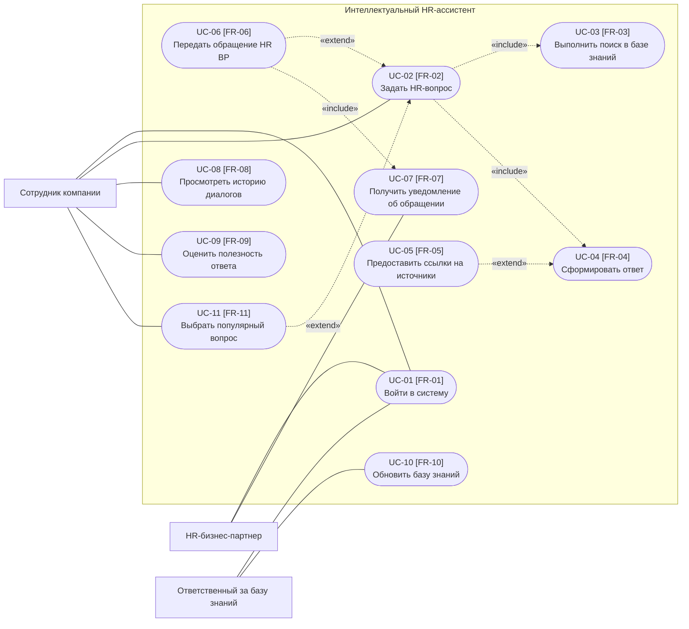

# Лабораторная работа №1. Формулирование требований к программной системе

| Поле | Значение |
|---|---|
| **Студент** | Палкина Юлия Андреевна |
| **Группа** | РИС-23-4 |
| **Вариант** | Индивидуальный вариант - интеллектуальный HR-ассистент |
| **Постановка задачи** | [Описание программной системы](../../README.md) |
| **Репозиторий** | [Ссылка на репозиторий GitHub](https://github.com/palkinayulia/hr-assistant) |
| **Дата сдачи** | ДД.12.2026 |

**Тема:** Анализ предметной области и формулирование требований к программной системе.

**Цель работы:** Научиться анализировать поставленную задачу, выделять заинтересованных лиц, формулировать функциональные и нефункциональные требования, представлять результаты в виде диаграммы вариантов использования.

---

## Краткое описание системы

Интеллектуальный HR-ассистент представляет собой программную систему, предназначенную для автоматизации обработки типовых обращений сотрудников компании по HR-вопросам. Система предоставляет ответы на основе корпоративной базы знаний и обеспечивает передачу сложных и нестандартных обращений закрепленному за сотрудником HR-бизнес-партнеру. Основными пользователями системы являются сотрудники компании и HR-бизнес-партнеры. Разработка системы направлена на снижение операционной нагрузки на HR-бизнес-партнеров, сокращение времени получения ответов и повышение доступности HR-информации для сотрудников.

---

## Оглавление

1. [Стейкхолдеры](#1-перечень-заинтересованных-лиц-стейкхолдеров)
2. [Функциональные требования](#2-перечень-функциональных-требований)
3. [Диаграмма вариантов использования](#3-диаграмма-вариантов-использования)
4. [Нефункциональные требования](#4-перечень-нефункциональных-требований)
5. [Предположения](#5-перечень-сделанных-предположений-повышенная-сложность)
6. [Чек-лист самопроверки](#6-чек-лист-самопроверки)

---
## 1. Перечень заинтересованных лиц (стейкхолдеров)

В рамках анализа предметной области выделено пять стейкхолдеров, среди которых четыре внутренних и один внешний. Каждый из них имеет собственные интересы и оказывает определенное влияние на требования к разрабатываемой системе.

| ID | Стейкхолдер | Роль | Интересы / цели | Влияние |
|----|-------------|------|-----------------|---------|
| SH-01 | Сотрудники компании | Основные пользователи | Быстрое получение актуальной HR-информации без прямого обращения к HR BP | Высокое |
| SH-02 | HR-бизнес-партнеры | Обработка нестандартных обращений | Снижение количества типовых запросов и освобождение времени для более сложных задач | Высокое |
| SH-03 | Руководство HR-функции | Бизнес-заказчик системы | Повышение эффективности HR-процессов и снижение операционной нагрузки | Высокое |
| SH-04 | Ответственные за базу знаний | Поддержка информационного наполнения системы | Обеспечение актуальности и достоверности предоставляемой информации | Среднее |
| SH-05 | Поставщик внешней языковой модели | Внешний поставщик технологического решения | Использование предоставляемого сервиса в соответствии с условиями его эксплуатации | Среднее |

---
## 2. Перечень функциональных требований

На основе анализа предметной области и потребностей заинтересованных лиц сформулировано 12 функциональных требований к интеллектуальному HR-ассистенту. Для определения значимости требований использован метод MoSCoW, позволяющий разделить функциональные возможности системы на обязательные, важные, дополнительные и не планируемые к реализации в текущей версии.

| ID | Требование | Стейкхолдер | Приоритет (MoSCoW) | Обоснование |
|----|------------|-------------|---------------------|-------------|
| FR-01 | Система должна обеспечивать аутентификацию пользователей | SH-01, SH-02 | Must | Ограничение доступа к корпоративной информации |
| FR-02 | Сотрудник может задавать HR-вопросы на естественном языке | SH-01 | Must | Основной способ взаимодействия с ассистентом |
| FR-03 | Система должна осуществлять поиск релевантной информации в базе знаний | SH-01, SH-04 | Must | Получение достоверной корпоративной информации |
| FR-04 | Система должна формировать ответы на основе найденной информации | SH-01, SH-03 | Must | Реализация основного назначения системы |
| FR-05 | Система должна предоставлять ссылки на источники информации в ответах | SH-01 | Should | Возможность проверки достоверности ответа |
| FR-06 | Система должна передавать обращение закрепленному HR-бизнес-партнеру при невозможности сформировать достоверный ответ | SH-01, SH-02 | Must | Обеспечение обработки сложных и нестандартных вопросов |
| FR-07 | HR-бизнес-партнер должен получать уведомление о переданном обращении с содержанием вопроса сотрудника | SH-02 | Must | Обеспечение дальнейшей обработки обращения |
| FR-08 | Сотрудник может просматривать историю своих диалогов с ассистентом | SH-01 | Should | Повторный доступ к ранее полученной информации |
| FR-09 | Сотрудник может оценивать полезность полученного ответа | SH-01, SH-03 | Should | Получение обратной связи для улучшения системы |
| FR-10 | Система должна обеспечивать возможность обновления базы знаний | SH-04 | Must | Поддержание актуальности предоставляемой информации |
| FR-11 | Система может предоставлять список популярных HR-вопросов для быстрого выбора | SH-01 | Could | Упрощение взаимодействия с ассистентом |
| FR-12 | Интеграция с корпоративными мессенджерами не предусматривается в текущей версии системы | SH-01, SH-03 | Won't | Интеграция предполагается в последующих версиях системы |

---
## 3. Диаграмма вариантов использования

Диаграмма вариантов использования построена с помощью Mermaid и отражает основные сценарии взаимодействия пользователей с интеллектуальным HR-ассистентом. На диаграмме представлены три актора и одиннадцать вариантов использования, соответствующих функциональным требованиям системы.

Требование FR-12 не представлено на диаграмме, поскольку интеграция с корпоративными мессенджерами не предусматривается в текущей версии системы.

**Связь с требованиями:** ID соответствующего FR указан в названии каждого Use Case.

### Диаграмма

### Описание ключевого сценария

| Поле | Значение |
|---|---|
| **Use Case** | UC-02 [FR-02] Задать HR-вопрос |
| **Актор** | Сотрудник компании |
| **Предусловие** | Сотрудник аутентифицирован в системе. База знаний доступна для поиска информации. |
| **Основной поток** | 1. Сотрудник открывает чат с интеллектуальным ассистентом. → 2. Сотрудник вводит вопрос на естественном языке. → 3. Система выполняет поиск релевантной информации в базе знаний. → 4. Система формирует ответ на основе найденной информации. → 5. Система отображает ответ сотруднику и предоставляет ссылки на источники при их наличии. → 6. Система сохраняет вопрос и ответ в истории диалога. |
| **Постусловие** | Сотрудник получил ответ на HR-вопрос. Информация о взаимодействии сохранена в истории диалога. |
| **Альтернативный поток** | Если система не находит достаточной информации для формирования достоверного ответа, она сообщает об этом сотруднику и передает обращение закрепленному HR-бизнес-партнеру. HR-бизнес-партнер получает уведомление с содержанием вопроса сотрудника. |

---
## 4. Перечень нефункциональных требований

На основе целей разработки системы и потребностей заинтересованных лиц выделено пять нефункциональных требований, характеризующих производительность, масштабируемость, безопасность, надежность и удобство использования интеллектуального HR-ассистента.

Выбранные требования направлены на обеспечение оперативного получения ответов, защиту корпоративной информации и комфортное взаимодействие сотрудников с системой. Требования к круглосуточной доступности и поддержке высокой промышленной нагрузки не рассматриваются на этапе разработки первой версии системы в связи с ограниченными ресурсами и отсутствием определенной инфраструктуры развертывания.

| ID | Категория | Требование | Метрика / критерий приёмки | Почему выбрано |
|----|-----------|------------|----------------------------|----------------|
| NFR-01 | Performance | Система должна обеспечивать оперативное получение ответов на вопросы сотрудников | Не менее 95% типовых запросов обрабатываются за 10 секунд или быстрее при работе одного пользователя | Сокращение времени ожидания ответа является одной из основных целей системы |
| NFR-02 | Scalability | Система должна поддерживать одновременную работу нескольких пользователей | Не менее 10 одновременных пользователей; увеличение времени ответа p95 не более чем на 30% относительно работы одного пользователя | Системой могут одновременно пользоваться сотрудники разных подразделений |
| NFR-03 | Security | Система должна обеспечивать защиту информации от несанкционированного доступа | 100% тестовых попыток доступа без аутентификации или к чужой истории диалогов отклоняются | Система работает с корпоративной информацией и обращениями сотрудников |
| NFR-04 | Reliability | Система должна обеспечивать сохранность истории диалогов и переданных обращений | 100% успешно сохраненных диалогов и обращений доступны после перезапуска системы | Потеря информации может привести к повторным обращениям сотрудников |
| NFR-05 | Usability | Интерфейс системы должен быть понятен пользователям без специальной подготовки | Не менее 90% участников тестирования самостоятельно задают вопрос и получают ответ в течение одной минуты | Система предназначена для сотрудников с разным уровнем технической подготовки |

---
## 5. Перечень сделанных предположений (повышенная сложность)

В связи с отсутствием в первоначальной постановке задачи детального описания условий эксплуатации, технической инфраструктуры и организационных особенностей компании сформулирован ряд предположений. Данные предположения позволяют определить границы разрабатываемой системы и уточнить требования к ее функциональным возможностям.

| ID | Предположение | Влияние на требования |
|----|---------------|-----------------------|
| A-01 | Система предназначена для использования сотрудниками одной компании | Определяет границы системы и требования к масштабируемости (FR-01, NFR-02) |
| A-02 | Взаимодействие с ассистентом осуществляется на русском языке | Определяет требования к обработке вопросов и формированию ответов (FR-02, FR-03, FR-04) |
| A-03 | Компания располагает корпоративной базой знаний, содержащей актуальную информацию о HR-процессах | Обеспечивает возможность поиска информации и формирования достоверных ответов (FR-03, FR-04, FR-05, FR-10) |
| A-04 | За каждым сотрудником закреплен HR-бизнес-партнер, контактные данные которого доступны системе | Обеспечивает корректную передачу нестандартных обращений (FR-06, FR-07) |
| A-05 | Ассистент выполняет консультационную функцию и не принимает кадровых решений | Ограничивает область автоматизации системы (FR-04, FR-06) |
| A-06 | В первой версии взаимодействие с системой осуществляется через веб-интерфейс | Позволяет отложить интеграцию с корпоративными мессенджерами (FR-12, NFR-05) |
| A-07 | Допускается использование внешнего сервиса языковой модели при соблюдении требований информационной безопасности | Влияет на формирование ответов, производительность и безопасность системы (FR-04, NFR-01, NFR-03) |
| A-08 | Первая версия системы разрабатывается как функциональный прототип с ограниченным количеством пользователей | Определяет целевые показатели производительности и масштабируемости (NFR-01, NFR-02) |

---
## 6. Чек-лист самопроверки

- [x] README содержит ФИО, группу, вариант, постановку.
- [x] Все таблицы имеют ID (SH-, FR-, A-, NFR-).
- [x] Каждое FR привязано хотя бы к одному стейкхолдеру.
- [x] Каждый Use Case на диаграмме соответствует FR.
- [x] Есть минимум один внешний стейкхолдер.
- [x] NFR измеримы (числа, проценты, сроки).
- [x] Исходник диаграммы закоммичен.
- [x] Нет требований вида «система должна быть удобной/надёжной» без метрики.
