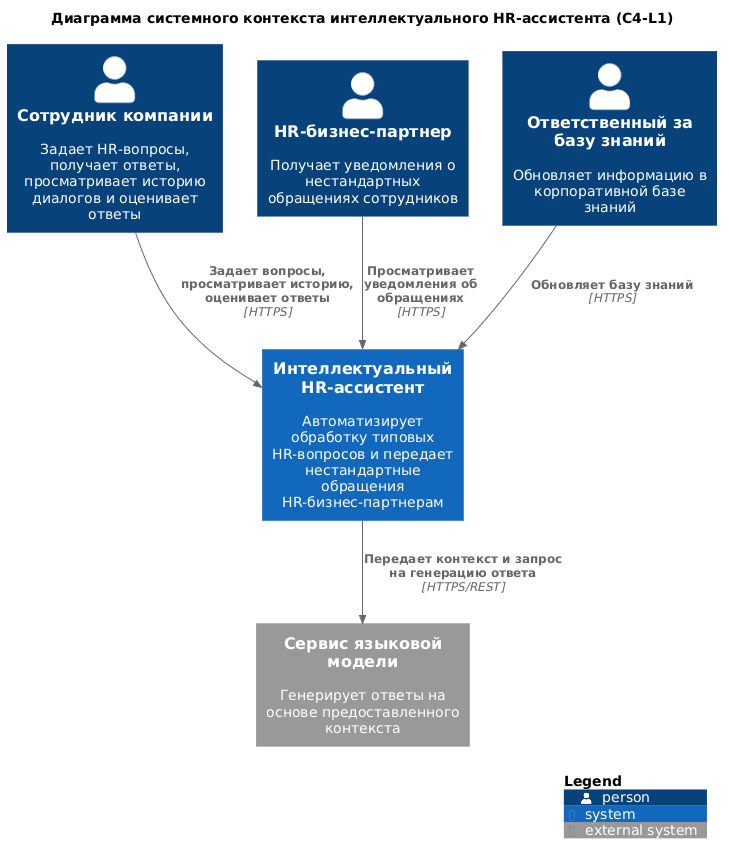

# Лабораторная работа №2. C4 model для проектирования архитектуры программной системы

## Титульный блок

| Поле | Значение |
|---|---|
| **Студент** | Палкина Юлия Андреевна |
| **Группа** | РИС-23-4 |
| **Вариант** | Индивидуальный вариант - интеллектуальный HR-ассистент |
| **Ссылка на ЛР №1** | [Лабораторная работа №1](https://github.com/palkinayulia/hr-assistant/blob/lab-1/Lab%20Work%20%E2%84%961/docs/LAB_1_REPORT.md) |
| **Репозиторий** | [Ссылка на репозиторий GitHub](https://github.com/palkinayulia/hr-assistant) |
| **Инструмент диаграмм** | C4-PlantUML |

**Тема:** Использование нотации C4 model для проектирования архитектуры программной системы.

**Цель:** Получить опыт использования графической нотации для фиксации архитектурных решений.

---

## Краткое описание системы

Интеллектуальный HR-ассистент представляет собой программную систему, предназначенную для автоматизации обработки типовых обращений сотрудников компании по HR-вопросам. Система формирует ответы на основе корпоративной базы знаний с использованием внешней языковой модели, а при невозможности предоставления достоверного ответа передает обращение закрепленному за сотрудником HR-бизнес-партнеру. Взаимодействие с системой осуществляется через веб-интерфейс.

Подробное описание функциональных и нефункциональных требований представлено в лабораторной работе №1.

**Ключевые NFR из ЛР №1, влияющие на архитектуру:**

- **NFR-01 (Performance)** - не менее 95% типовых запросов обрабатываются за 10 секунд или быстрее при работе одного пользователя.
- **NFR-02 (Scalability)** - поддержка не менее 10 одновременных пользователей с увеличением времени ответа p95 не более чем на 30% относительно работы одного пользователя.
- **NFR-03 (Security)** - 100% тестовых попыток доступа без аутентификации или к чужой истории диалогов отклоняются.
- **NFR-04 (Reliability)** - 100% успешно сохраненных диалогов и обращений доступны после перезапуска системы.
- **NFR-05 (Usability)** - не менее 90% участников тестирования самостоятельно задают вопрос и получают ответ в течение одной минуты.

---

## Оглавление

1. [Диаграмма системного контекста](#1-диаграмма-системного-контекста)
2. [Диаграмма контейнеров](#2-диаграмма-контейнеров)
3. [Диаграмма компонентов](#3-диаграмма-компонентов)
4. [Компоненты второго контейнера](#4-компоненты-второго-контейнера)

---
## 1. Диаграмма системного контекста

Диаграмма системного контекста отражает взаимодействие интеллектуального HR-ассистента с основными пользователями и внешней системой. На диаграмме представлены три актора, выделенные в лабораторной работе №1, а также внешний сервис языковой модели, используемый для формирования ответов на вопросы сотрудников.

### Диаграмма

### Описание элементов

| Элемент | Тип | Назначение |
|---|---|---|
| Сотрудник компании | Person | Задает HR-вопросы, получает ответы со ссылками на источники, просматривает историю диалогов и оценивает полезность ответов |
| HR-бизнес-партнер | Person | Получает уведомления о переданных нестандартных обращениях сотрудников |
| Ответственный за базу знаний | Person | Обновляет информацию в корпоративной базе знаний и поддерживает ее актуальность |
| Интеллектуальный HR-ассистент | System | Автоматизирует обработку типовых HR-вопросов, формирует ответы на основе базы знаний и передает нестандартные обращения HR-бизнес-партнерам |
| Сервис языковой модели | External System | Обеспечивает генерацию ответов на естественном языке на основе предоставленного контекста |

### Внешние интеграции

| Внешняя система | Протокол | Назначение |
|---|---|---|
| Сервис языковой модели | HTTPS/REST | Передача вопроса и релевантного контекста из базы знаний для генерации ответа на естественном языке |

Взаимодействие пользователей с интеллектуальным HR-ассистентом осуществляется через веб-интерфейс по протоколу HTTPS. Интеграция с корпоративными мессенджерами в текущей версии системы не предусматривается в соответствии с требованием FR-12.

---
